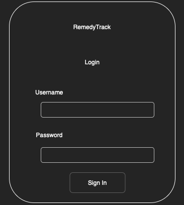
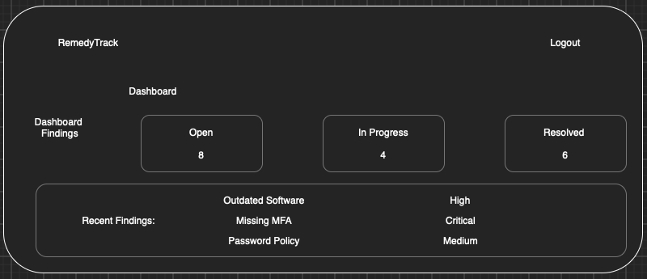
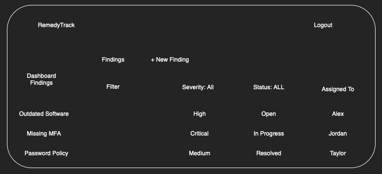
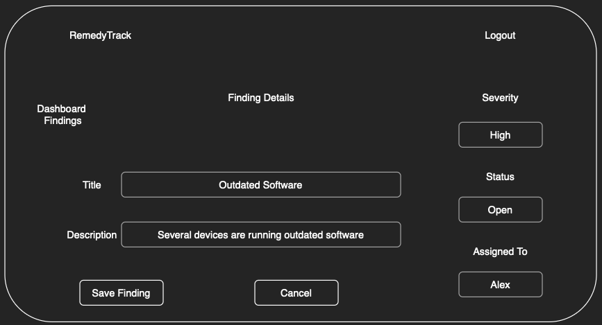

# RemedyTrack Documentation

## User Stories

### User Story 1 - User Login

As an **authorized user**, I want to **log in to RemedyTrack** so I can **access and manage cybersecurity findings**.

Acceptance Criteria:
- Users can log in with a valid username and password.
- Invalid login credentials are rejected.
- Users must be logged in before accessing findings.

### User Story 2 - Create Findings

As a **security analyst**, I want to **record new cybersecurity findings** so I can **document issues identified during a security assessment**.

Acceptance Criteria:
- A user can create a finding with a title, description, and severity level.
- Required fields must be completed before a finding can be saved.
- Saved findings appear in the findings list.

### User Story 3 - Assign Findings

As a **security analyst**, I want to **assign findings to IT staff members** so I can **identify who is responsible for addressing each issue**.

Acceptance Criteria:
- A finding can be assigned to an existing user.
- The assigned user is displayed when viewing a finding.
- A security analyst can change the assignment when necessary.

### User Story 4 - Update Remediation Status

As an **IT staff member**, I want to **update the status of findings assigned to me** so I can **show the progress being made toward resolving them**.

Acceptance Criteria:
- Assigned users can change a finding's status to Open, In Progress, or Resolved.
- Status changes are saved and displayed when the finding is viewed again.
- Users cannot modify findings assigned to someone else unless they have administrative permission.

### User Story 5 - View and Filter Findings

As a **security analyst**, I want to **filter findings by severity and status** so I can **focus on issues that require attention**.

Acceptance Criteria:
- Findings can be filtered by severity level.
- Findings can be filtered by remediation status.
- Users can clear filters to view all findings.

### User Story 6 - View Dashboard

As a **security analyst**, I want to **view a dashboard showing the status of findings** so I can **quickly identify outstanding security issues**.

Acceptance Criteria:
- The dashboard displays the number of Open, In Progress, and Resolved findings.
- The displayed counts reflect the findings stored in the application.
- Users can navigate from the dashboard to the findings list.

## Mis-user Stories

### Mis-user Story 1 - Unauthorized Access

As an **unauthenticated user**, I want to **access cybersecurity findings without logging in** so I can **view information that I am not authorized to see**.

Mitigation Criteria:
- Users must authenticate before accessing the dashboard or findings.
- Unauthenticated users attempting to access protected pages are redirected to the login page.
- Finding information is not displayed to unauthenticated users.

### Mis-user Story 2 - Unauthorized Modification

As a malicious **IT staff member**, I want to **modify findings assigned to other employees** so I can **change remediation information without permission**.

Mitigation Criteria:
- IT staff can only update findings assigned to them.
- Administrative users can update findings regardless of assignment.
- Unauthorized modification attempts are rejected, including requests made directly through a URL.

### Mis-user Story 3 - Malicious Input

As a **malicious user**, I want to **insert executable scripts into finding descriptions** so I can **run unauthorized code in another user's browser**.

Mitigation Criteria:
- Finding descriptions are displayed as text rather than executable HTML or JavaScript.
- Entering a script into a finding description does not cause it to execute when another user views the finding.

### Mis-user Story 4 - Forged Requests

As an **external attacker**, I want to **trick an authenticated user into submitting an unauthorized request** so I can **change finding information without their knowledge**.

Mitigation Criteria:
- Forms that modify application data use Django's CSRF protection.
- Requests with missing or invalid CSRF tokens are rejected.
- Rejected requests do not modify any finding information.

## Application Mockups

### Sign In

### Dashboard

### Findings List

### Finding Details

